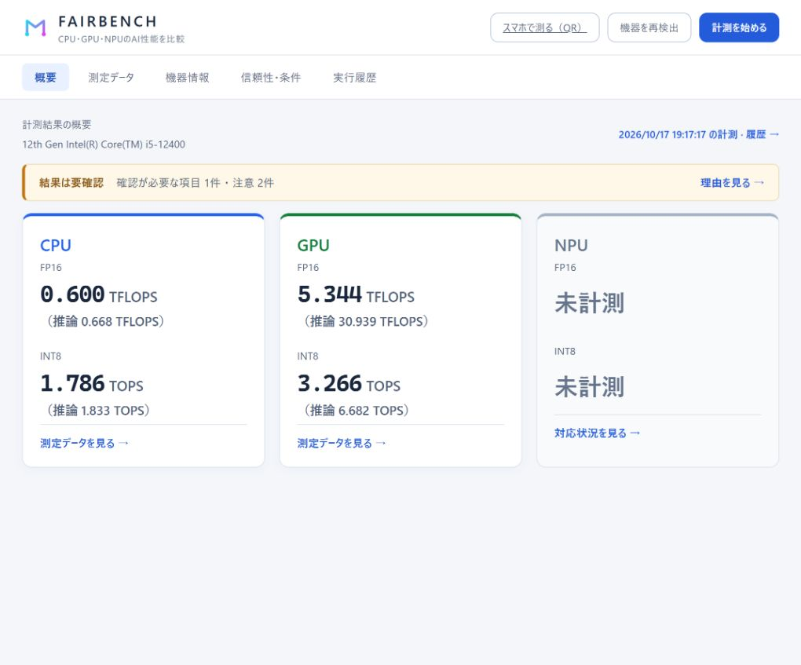
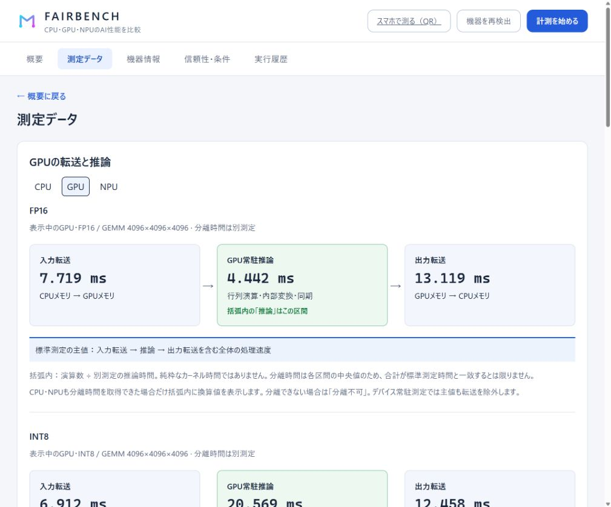

# fairbench

CPU・GPU・NPUで同じONNXモデルを実行し、処理速度と測定条件を比較するベンチマークです。
**表示値はモデルの実測処理性能であり、メーカーの理論ピーク性能ではありません。**

## 実際の画面

開発PCの保存済み測定結果を表示した実画面です。数値は表示例で、性能を保証するものではありません。この例ではNPUは未検出です。

**概要：CPU・GPU・NPUのFP16 / INT8性能**



**測定データ：デバイスを切り替えて転送・推論時間を確認**



## はじめる

Python環境は[uv](https://docs.astral.sh/uv/)で用意します。このリポジトリで実行してください。

```sh
uv sync
uv run fairbench devices
uv run fairbench serve
```

画面の「計測を始める」から、機器・行列サイズ・回数を指定します。測定時間は内部の既定値で管理します。
既定は **FP16・INT8 / 4096×4096 / 1並列 / 3回**。正解照合は常時有効です。
バックエンド・テスト項目・並列実行・電源条件は「詳細設定」にあります。
比較時はAC電源・電源設定・バックグラウンド負荷をそろえてください。結果は`results/`にJSONで保存されます。

プレゼンテーション・報告書には「報告書」ページを使います。表示中の結果の概要・グラフ・全測定値・信頼性・計測条件をまとめて「HTMLで保存」できます。保存したHTMLはアプリなしで開けます。「印刷・PDFで保存」から印刷画面を開き、PDF保存もできます。過去の結果は「実行履歴」で選んでから保存してください。
PowerPointには、各ブロックの「画像をコピー」を押してからCtrl+Vで貼り付けます。「PNGで保存」から画像ファイルとして挿入することもできます。画像には測定日時・元データ・測定範囲の注意書きが付きます。

CLIで測定する場合：

```sh
uv run fairbench run
uv run fairbench run --gemm-size 2048
uv run fairbench run --quick
```

`--quick`は最小限の動作確認用です。標準ではFP16・INT8を4096×4096行列・各1回、ウォームアップ1回・本計測1回で実行します。行列サイズは`--gemm-size`で変更できます。電力測定・待機時間・負荷探索・演算精度プロファイルを省略し、正解照合と推論時間の分離測定（5サンプルの中央値）は残します。指定方法の一覧は`uv run fairbench run --help`で確認できます。

## 結果の各項目

msはミリ秒、infは推論1回です。`—`は未取得・対象外、`failed`は測定失敗を示します。

| 項目 | 意味・読み方 |
| --- | --- |
| **device** | 実行デバイスとランタイム。例：ORT DirectML GPU、OpenVINO CPU。 |
| **workload** | 実行したモデル・負荷の識別名。同じ名前・サイズ・精度で比較します。 |
| **GEMM M×K×N** | 行列積のサイズ。AはM×K、BはK×N、出力はM×N。既定は4096×4096×4096。 |
| **モデル精度** | モデルで指定したFP16・INT8などの精度。実際の演算精度とは限りません。 |
| **演算精度・入力型** | ランタイムが報告した演算精度、または演算入力の型。GPU割当グラフ型はハードウェア命令・蓄積精度の証明ではなく、確認できないものは未確認と表示します。 |
| **units/s** | 1秒あたりの完了推論数。モデルの単位はsample・image・tokenなど。各試行の処理量の中央値で、大きいほど高速。並列測定では全レーンの合計です。 |
| **median ms** | 各試行で求めた推論時間の中央値を、さらに試行間で中央値にした値。小さいほど低遅延。 |
| **p90 ms** | 推論時間の90パーセンタイル。約90%の推論がこの時間以内に完了。現在の表では、中央値が最小の試行の統計です。 |
| **CV** | 試行内のばらつき：標準偏差÷平均×100%。小さいほど安定。p90と同じ試行の値で、外れ値を含みます。 |
| **演算性能（測定範囲内）** | モデルの演算数×units/s。FP16はTFLOPS、INT8はTOPS。転送・内部変換を含む範囲は測定モードに依存します。 |
| **入力転送・準備 ms** | 別測定した入力転送、またはホスト入力バッファへのコピー時間。CPU・NPUのホスト側コピーは物理的なデバイス転送とは区別します。 |
| **推論・同期 ms** | 別測定した同期推論時間。呼び出し・型変換・量子化などを含み、NPU等ではランタイム内部の転送も残る場合があります。純粋なカーネル時間ではありません。 |
| **出力転送・取得 ms** | 別測定した出力転送、またはホスト出力配列へのコピー時間。 |
| **成功回数** | 成功した独立試行数／指定試行数。例：3/3。各試行内の推論回数ではありません。 |
| **host CPU s/inf** | 推論1回あたりのホストCPU消費時間（秒）。実時間ではなく、複数CPUスレッドの時間を合計するため、推論の経過時間を超える場合があります。 |
| **W** | 測定中の平均消費電力。取得可能な電力計・バッテリーによるPC全体の値で、GPU・NPU単体の電力ではありません。 |
| **J/inf** | 推論1回のエネルギー：平均W÷units/s。小さいほど省エネルギー。現在は個別試行JSONに記録されますが、集約表には未反映のため`—`になります。 |
| **compile ms** | モデルの読込・変換・コンパイル等の準備時間の試行間中央値。推論時間とは別で、キャッシュの影響を受けます。 |
| **spread** | 試行間の速度差：(最大units/s−最小units/s)÷中央値×100%。小さいほど再現性が高く、成功試行が1回以下では判定不可です。 |

**集計の注意：** p90・CVは全試行を合算した統計ではありません。またunits/sは計測区間の完了数÷実時間なので、`1000÷median ms`と一致するとは限りません。

## TFLOPS・TOPSの算出と測定範囲

1 MAC（乗算＋加算）を2演算と数えます。

```text
GEMM演算数 = 2 × M × K × N
TFLOPS / TOPS = GEMM演算数 × 完了推論数 ÷ 測定秒数 ÷ 10^12
```

概要の主値は、別測定の推論時間から換算した参考値です。通常計測では30サンプル以上かつ指定秒数以上の推論時間を目標に採取し、試行ごとの中央値をさらに試行間で中央値に集約します。上限時間・回数で打ち切ります。測定データには推論サンプル数と試行内の最大CVを表示し、5%を超えるばらつきは明記します。分離時間がない場合は「分離不可」と表示します。
括弧内の「E2E」は推論と同じ試行で測った「入力転送・準備 → 推論 → 出力転送・取得」の全体時間から換算します。従来のunits/sによる独立した測定値は測定データ表に残します。古い保存結果は同時測定のE2Eがないため従来値を表示します。デバイス常駐測定では転送込みE2Eは未取得です。
分離時間は各区間の中央値なので、足しても標準測定の時間と一致するとは限りません。
転送・推論の図とCPU・GPU・NPUの切替は「測定データ」ページにあります。

FP16モデルがCPUでFP32実行される場合や、INT8モデルでもネイティブINT8命令を確認できない場合があります。
理論値との比較には、実行精度・MACの数え方・疎性・サイズ・並列数・転送範囲をそろえる必要があります。FP8・INT4のネイティブ測定は未対応です。

「負荷探索」はサイズ・並列数等をデバイスごとに選ぶ実験用モードです。採用条件で再測定しますが、異なる条件のデバイス間比較や理論最大値の保証には使えません。
並列数は空きRAMから保守的に制限します。ただし、実メモリ使用量・スワップを監視する仕組みではありません。

正解照合はCPUのFP32参照に対し、全出力の形状・有限値と、各出力最大16,384要素の相対L2誤差（既定5%以内）を確認します。
旧方式の保存結果や未記録の分離時間を補うには、再計測してください。

## GPU・NPUとスマートフォン

GPUの合計処理性能を測る場合は、詳細設定で「throughput」を選択します。対応GPUでは入出力バッファを再利用し、指定並列数（自動なら1・2・4・8）の処理量を測ります。概要の主値は並列処理全体のスループットで、単発の分離推論時間から換算した値とは区別します。OpenVINOの固定リクエストにはランタイム内部転送が含まれ、純粋なGPUカーネル性能ではありません。

NPUのthroughput測定でも、OpenVINOとWindows ML Vitis AIで入出力バッファを再利用します。自動並列数は1・2・4・8・16・32です。Vitis AIではホスト側のバッファを固定するため、NPU内部の転送・変換時間は残ります。Windows MLにも共通のVitis AIプロバイダー設定を渡し、適用した設定を各試行の`session.provider_options`へ記録します。

Vitis AIのINT8精度別GEMMでは、既定のX2ターゲットに対して同梱の`fairbench/vitisai_int8_gemm.json`を適用し、`enable_matmul_to_conv=false`を指定します。4096×4096の実機測定で、MatMulを畳み込みへ変換する経路に過剰な演算・転送が生じたためです。ONNXモデル、量子化、演算数は変更しません。ユーザー指定の`config_file`・`target_opts`・`xclbin`、およびX2以外の明示的ターゲットは優先し、この最適化を追加しません。

この設定はWindows ML 2.4.89 / ORT 1.27.1のVitis AI EP（メタデータ版0.1.0）が出力したX2パス設定を基に、上記変換を無効にしたものです。Ryzen AI 7 445、ドライバー32.0.203.329で検証しています。このEPは単独の`target_opts`指定を反映しなかったため、パス設定を含めています。ランタイム更新時は互換性・性能を再検証してください。設定が非対応の場合、別精度やCPUへ切り替えて成功扱いにはしません。

Vitis AIの「CPUフォールバック禁止」は、ONNX RuntimeのCPU EPへの割当を禁止する設定です。Vitis AI内部のCPU処理まで禁止するものではありません。したがって、INT8モデルのTOPSや分離推論時間を、ネイティブINT8のNPUカーネル性能と同一視できません。

AMD NPUはAMDアカウントを使わずWindows MLのEP Catalogから準備できます。AMD機上で`uv run fairbench setup-npu`を実行し、続けて`uv run python -m scripts.validate_amd_npu`で4096×4096のFP16・INT8を検証します。CPUフォールバック禁止と正解照合を維持し、成功・失敗とも測定結果を`results/`へ保存します。両精度の成功時だけ終了コード0を返します。

Vitis AIのプロバイダーはDLLと同じディレクトリのファイル一式（サブディレクトリを含む）を`.cache/windowsml/`へコピーして登録します。INT8 GEMMは符号付き対称・テンソル単位の量子化と出力QDQを使用します。旧INT8モデルとはグラフが異なるため、比較には再計測が必要です。FP16モデルのNPU対応は実機ランタイムに依存し、未対応時に別精度やCPUへ切り替えて成功扱いにはしません。

Windows x64ではDirectMLとOpenVINOを導入します。GPU・NPUには対応ハードウェアとメーカー製ドライバーが必要です。
搭載されていないNPUや非対応の精度は測定できません。

| コマンド（`uv run fairbench`に続ける） | 用途 |
| --- | --- |
| `verify` / `selftest` | デバイスの推論確認／対応ワークロードの診断。 |
| `setup-winml` | Windows ML環境を準備。対応するWindows・ドライバーが必要。 |
| `setup-winml --tensorrt` | Windows MLのTensorRT-RTXプロバイダーを導入し、NVIDIA GPUの公開を確認。 |
| `setup-npu` | WindowsのAMD NPU（Vitis AI）環境を準備・推論確認。 |
| `setup-gpu --cuda` | NVIDIA CUDA用の独立環境を準備。 |
| `setup-gpu --tensorrt` | TensorRT 10・CUDA 12の独立環境を準備。NVIDIA GPUのINT8行列積を検証して測定。 |
| `show results/<file>.json` | 保存結果を表示。 |

ORTのCPU・DirectML・CUDA・メーカー専用版は同じPython環境に混在させないでください。追加のPython環境は`FAIRBENCH_PYTHON`でも指定できます。

RTX 3060 TiなどのNVIDIA GPUでINT8を確認して測る場合:

```powershell
uv run fairbench setup-gpu --tensorrt
uv run fairbench run --backend tensorrt --workloads precision_gemm_int8 --mode throughput --requests 1 --gemm-size 4096
```

準備後は画面の測定対象にも「TensorRT GPU」が現れます。TensorRT経路は同じONNXモデルを強い型付けでコンパイルし、測定対象エンジンのEngine Inspectorから行列積のINT8入力・重み（埋め込み重みの場合はINT8×INT8を示すtactic）を確認します。INT8の実装が選ばれていなければ失敗とし、CPU・FP32へ切り替えて成功扱いにはしません。実行成功後にエンジンのSHA256、Inspector情報、GPU名、TensorRT版を結果JSONへ保存します。INT8では`--quick`でも精度確認を省略せず、`--no-check`でも出力の正解照合を実施します。

throughputはGPU常駐バッファで測定し、入力・出力転送を除外します。同期・起動・量子化／逆量子化の時間は含み、1 MAC = 2演算の行列積演算数からTOPSを算出します。蓄積精度と命令の逆アセンブルは未検証です。DirectMLの既存結果はINT8モデルの換算値として区別してください。TensorRTの確認方法は[NVIDIA Engine Inspector資料](https://docs.nvidia.com/deeplearning/tensorrt/10.x.x/inference-library/engine-tools.html)に基づきます。

AMD GPUはWindows ML EP Catalogの`MIGraphXExecutionProvider`からも計測できます。[Microsoftの対応表](https://learn.microsoft.com/ja-jp/windows/ai/new-windows-ml/supported-execution-providers?tabs=winml2)では、Windows 11 24H2以降、RDNA 3以降のGPU、AMD GPUドライバー25.10.13.09以降が要件です。GenAI用途は未対応です。

```powershell
uv run fairbench setup-winml --migraphx
uv run fairbench verify --targets MIGraphXExecutionProvider
uv run fairbench run --backend winml --targets MIGraphXExecutionProvider --mode throughput --requests 1
.venv-winml/Scripts/python.exe -m scripts.validate_winml_gpu
```

GUIでは「機器を再検出」後に`Windows ML MIGraphX GPU`を選択します。Windows MLのデバイス指定APIでGPUを固定し、測定するセッションを事前にプロファイルしてGPUへの割当を検証します。CPUフォールバックは禁止します。FP16とINT8 QDQモデルを測定し、INT8の内部演算精度を確認できない場合はモデル換算値として表示します。throughputは固定ホストバッファを再利用しますが、ランタイム内部のGPU転送は含まれます。

EPが列挙されても個々のGPU向けカーネルが配布物に含まれない場合は計測できません。Radeon 840M（gfx1153）ではEPパッケージ`1.8.64.0`が`invalid device function`で失敗することを確認しています。対応EPの配布が必要です。失敗理由は結果とWorker logへ保存します。この場合、現在のWindows ML `DmlExecutionProvider`経路は別の測定対象として選択でき、`scripts.validate_winml_gpu --provider dml`で検証できます。

AMD GPUのINT8精度別GEMMには、`AMD Vulkan INT8 GPU`も利用できます。Vulkan 1.3と`VK_KHR_cooperative_matrix`を使い、選択したAMD GPUが16×16×16の符号付きINT8入力・INT32蓄積に対応することを確認してから専用パイプラインを作成します。標準のINT8 QDQモデルだけを対象に、重み・入力・出力量子化のスケール、丸め、クリッピング、行列形状、演算数を維持します。GPU上の量子化・整数行列積・出力変換をまとめて測定し、正解照合は常に実行します。未対応モデル・ドライバーは失敗理由を記録し、FP16/FP32の行列積やCPUへ切り替えません。元のDirectML経路も比較用に利用できます。

```powershell
uv sync
uv run fairbench run --backend vulkan --workloads precision_gemm_int8 --mode throughput --requests 1 --gemm-size 4096
uv run python -m scripts.check_vulkan --hardware
```

Windows x64ではVulkanのPythonバインディングも導入します。対応するGPUドライバーが必要です。独立した`vulkan`バックエンドとして検出するため、GUIのGPU一覧では`AMD Vulkan INT8 GPU`を選択します。throughputは固定バッファでGPUの完了フェンスまで待ち、ホストとの入出力コピーを除外します。latencyとE2Eはコピーを含みます。ホストからも見えるGPUバッファを使い、GPUによるメモリアクセスは推論時間に含まれます。API上の演算精度と実行結果は確認しますが、GPU命令の逆アセンブルは行いません。

行列は16×16タイルごとに連続配置し、行列命令による飛び飛びのメモリー読み込みを減らします。定数の重みはコンパイル時に並べ替え、入力は毎回GPUの量子化処理内で並べ替えます。入力の並べ替え時間は測定に含みます。演算数・量子化条件は同じです。Radeon 840Mで4096×4096、throughput・並列数1、各3秒の交互測定を3回行った中央値は、変更前1.514 TOPS、変更後3.851 TOPSでした（約2.54倍）。これはこの機器・条件での実測結果です。

シェーダーのGLSLソースとSPIR-Vを`fairbench/shaders/`に同梱し、ソース・バイナリーのハッシュを検査します。実行にシェーダーコンパイラーは不要です。再生成には[Khronos glslang 16.6.0](https://github.com/KhronosGroup/glslang/releases/tag/16.6.0)を使い、`python -m scripts.build_vulkan_shaders --compiler <glslang.exeのパス>`を実行します。Vulkanの演算定義は[KHR_cooperative_matrix仕様](https://registry.khronos.org/vulkan/specs/latest/man/html/VK_KHR_cooperative_matrix.html)に基づきます。

Windows ML経由で呼ぶ場合は、Windows MLカタログのTensorRT-RTX EPを使います（前述のTensorRT 10直接実行とは別のランタイムです）。[対応機器・条件](https://learn.microsoft.com/windows/ai/new-windows-ml/supported-execution-providers)を確認し、次を実行してください。

```powershell
uv run fairbench setup-winml --tensorrt
uv run fairbench run --backend winml --targets NvTensorRTRTXExecutionProvider --workloads precision_gemm_fp16
```

画面では「機器を再検出」後に「Windows ML TensorRT-RTX GPU」を選べます。WinMLのデバイス指定APIで機器を固定し、CPUフォールバックを禁止します。測定セッション自体を1回プロファイルしてTensorRT-RTXへの割り当てを検証し、計測前にプロファイルを停止します。WinMLではホストバッファを使い、内部転送を含む推論時間として報告します。INT8 QDQモデルは実行・正解照合したうえで、内部INT8演算を検証できない場合も処理回数/秒と遅延を参考値として記録します。結果には`measurement_validity: model_only`を付け、`flops_per_s`はnullとします。モデル演算数×実測処理回数/秒の換算値を`model_operations_per_s`に分けて保存し、画面ではFP16・INT8の指定精度と実測性能を表示します。主値は推論区間、E2Eは入力から出力までの全体区間の実測時間に基づきます。4096角のGEMMなら`2×4096³×処理回数/秒÷10¹²`です。転送込みの測定では転送時間もこの換算値に含まれます。内部INT8演算の確認済み性能・メーカーの理論TOPSとは異なります。検証済みINT8を測る場合は`--backend tensorrt`を使ってください。

スマホではPCと同じWi-Fiに接続し、「スマホで測る（QR）」→「LAN配信を開始する」から開きます。
スマホ自身のブラウザでCPU・対応GPUのFP32を測定し、NPU・INT8は未対応です。PC版・理論値と直接比較できません。
LAN公開はスマホ用ページに限定され、PCの測定・履歴APIは公開しません。配信は画面から停止できます。

## 開発

```sh
uv run python -m scripts.check_refactor
uv run python -m scripts.check_precision
uv run python -m scripts.check_diagnostics
pwsh -File scripts/check-web.ps1
uv run ruff check fairbench scripts
```

Windows配布物は`pwsh -File scripts/build.ps1`で作成します。ZIPはPython不要のCPU・DirectML版で、OpenVINOを含みません。
